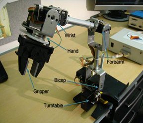
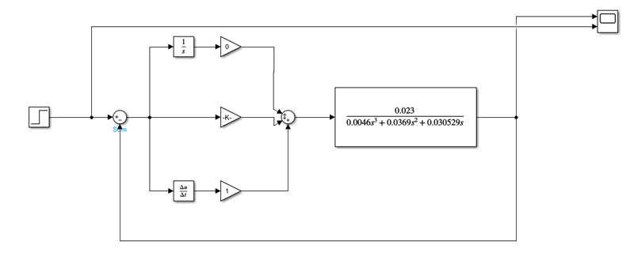
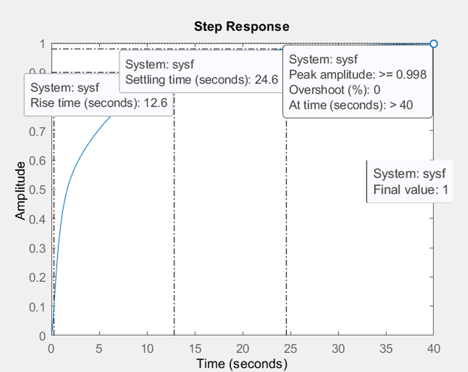

# Robotic Hand Control System — Dynamic Modeling & PID Tuning

-lightgrey)

> **Mathematical modeling, iterative PID controller tuning, and MATLAB/Simulink validation for a robotic hand actuator—achieving 0% overshoot and zero steady-state error.**

---

## 📄 Full Technical Report
👉 **[View / Download the Complete Technical Report (PDF)](docs/Robot_Hand_PID_Control_Report.pdf)**

---

## 🎯 Project Overview
Controlling robotic hand joints requires balancing response speed with strict stability to prevent mechanical overshoot during delicate grasping tasks. This project models the electromechanical dynamics of a robotic hand actuator as a continuous-time transfer function, designs a tuned feedback controller in MATLAB, and validates the closed-loop performance in Simulink.

- **Institution:** Saba University — Faculty of Engineering (Mechatronics Engineering)
- **Authors:** Afnan Aref, Abeer Saleh
- **Supervision:** Dr. Marwan & Eng. Alia'a Jaghman

---

## ⚙️ Mathematical Modeling
The open-loop robotic hand actuator is modeled by the continuous-time transfer function:

$$G(s) = \frac{K_t}{L J s^3 + (L B + R J) s^2 + (R B + K_t K_b) s} = \frac{0.023}{0.0046 s^3 + 0.0369 s^2 + 0.030529 s}$$

| Parameter | Symbol | Value |
| :--- | :---: | :---: |
| **Motor Torque Constant** | $K_t$ | $0.023\ \text{N}\cdot\text{m/A}$ |
| **Back-EMF Constant** | $K_b$ | $0.023\ \text{V}\cdot\text{s/rad}$ |
| **Armature Inductance** | $L$ | $0.23\ \text{H}$ |
| **Armature Resistance** | $R$ | $1\ \Omega$ |
| **Rotor Moment of Inertia** | $J$ | $0.02\ \text{kg}\cdot\text{m}^2$ |
| **Viscous Friction Coefficient** | $B$ | $0.03\ \text{N}\cdot\text{m}\cdot\text{s/rad}$ |

---

## 🛠️ Controller Design & Simulink Architecture
Because the open-loop plant inherently contains an integrator pole at the origin (resulting in an unbounded step response), an iterative empirical tuning methodology was carried out in MATLAB:
1. **Proportional ($K_p$):** Swept values to stabilize the closed-loop response and selected **$K_p = 0.29$**.
2. **Integral ($K_i$):** Evaluated integral action; set **$K_i = 0$** since the plant's natural integrator already eliminates steady-state error without introducing unnecessary overshoot.
3. **Derivative ($K_d$):** Tuned derivative damping to **$K_d = 1$** to smooth transients and eliminate oscillation.

---

## 📊 Performance Results
The final closed-loop system ($K_p = 0.29,\ K_i = 0,\ K_d = 1$) met all target design specifications:

| Performance Metric | Design Target | Achieved Result |
| :--- | :---: | :---: |
| **Overshoot (%)** | $0\%$ | **$0\%$** |
| **Settling Time** | $\le 25\ \text{s}$ | **$24.6\ \text{s}$** |
| **Rise Time** | $\le 15\ \text{s}$ | **$12.6\ \text{s}$** |
| **Steady-State Error** | $0$ | **$0$ (Final Value = 1)** |

---

## 📌 Note on Repository Scope
*This repository serves as the engineering documentation archive for the Digital Control course project, containing the complete technical report, mathematical derivations, MATLAB tuning scripts (documented in-report), and Simulink validation results.*
